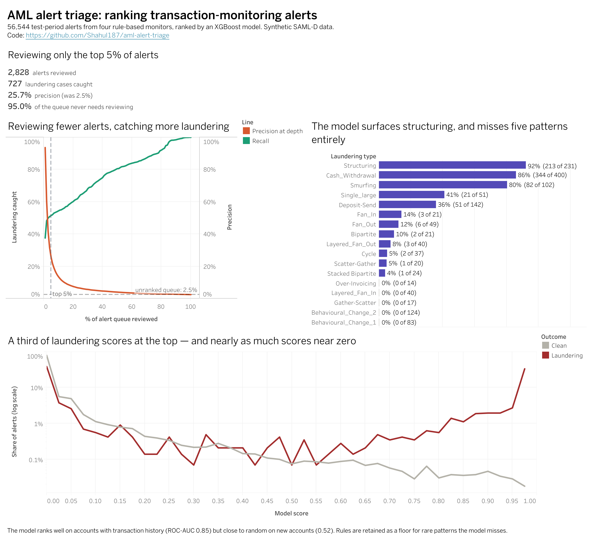

# AML alert triage: ranking transaction-monitoring alerts

Banks run rules that flag suspicious transactions for investigators to review. The rules are deliberately cautious, so the queue is huge and about 39 in every 40 alerts turn out to be innocent. This project builds that rules layer on 9.5 million synthetic transactions, then trains a model to rank the alert queue so investigators see the likeliest cases first.

**Result:** reviewing only the top 5% of ranked alerts catches about half of the laundering in the queue, at roughly 26% precision, about 1 in 4 reviewed alerts is real, against 1 in 40 unranked.

**Limitations:** the model only ranks well for accounts with transaction history, and it misses five laundering patterns entirely, including one the simple rules caught perfectly.

**Recommendation:** rank alerts with the model, but keep the rules running as a safety net for the patterns it misses.

*Click the image for the interactive version on Tableau Public.*

## The problem

Money laundering is the process of making criminal money look legitimate by moving it through ordinary bank accounts. Banks are legally required to watch for it, and most do so with **transaction monitoring**: a set of rules such as "flag small repeated cash withdrawals" or "flag any transfer over £50,000".

Rules are cheap to run and easy to justify to a regulator, but they are blunt. To avoid missing real cases they flag a lot of normal activity, and every alert must be reviewed by an investigator. Most reviews end with "nothing suspicious", and real cases sit buried in the noise.

This project asks a narrow, practical question: **if investigators can only review part of the queue, which alerts should they look at first?** It does not try to replace the rules. It ranks what they produce, which mirrors how banks actually split the work, with compliance owning the rules and analytics teams improving triage within the queue.

## Data

[SAML-D](https://www.kaggle.com/datasets/berkanoztas/synthetic-transaction-monitoring-dataset-aml) is a synthetic anti-money-laundering dataset published on Kaggle by Berkan Oztas and colleagues. Real bank transaction data is never public, so synthetic data with laundering patterns built in is the standard way to work on this problem openly.

| | |
|---|---|
| Transactions | 9,504,852 |
| Laundering | 9,873 (about 1 in 963) |
| Period | October 2022 to August 2023 (321 days) |
| Laundering patterns | 17 types, from structuring to over-invoicing |
| Geography | About 97% of senders UK-based, with cross-border flows to other countries |

**Working sample:** 9.5 million rows is heavy for free Google Colab, so I kept every laundering transaction and a random 16% of clean ones, giving 1.5 million rows. This raises the laundering rate in the sample to 0.65%, so the rates quoted below refer to the sample and the alert queue, not the full dataset. The sampling turned out to matter later: it broke the network structure that graph features would have needed (see [Limitations](#limitations)).

**Time-based split:** The model trains on alerts before 1 June 2023 and is tested on alerts from June to August 2023. A random split would let the model learn from the future, which it can never do in practice.

| | Alerts | Laundering |
|---|---|---|
| Train (Oct 2022 – May 2023) | 163,419 | 3,355 |
| Test (Jun – Aug 2023) | 56,544 | 1,416 |

The laundering label and pattern type are used only to train and evaluate the model, never as inputs.

## Approach

### 1. Building the alert queue

SAML-D has no alerts, only transactions with a hidden laundering label, so I wrote four simple monitoring rules from patterns found during exploration. Any transaction that matches at least one rule becomes an alert.

| Rule | Alerts | Precision | Laundering caught |
|---|---|---|---|
| Cash withdrawal under £400 | 48,771 | 2.7% | 13.5% |
| Any transfer over £50,000 | 12,824 | 3.1% | 4.1% |
| Cross-border payment | 150,057 | 2.0% | 30.8% |
| Cash deposit or withdrawal of £3,000–£7,000 | 10,120 | 4.9% | 5.0% |
| **Any rule** | **219,963** | **2.2%** | **48.3%** |

Figures are for the 1.5 million-row sample. The queue's precision of about 2% is in the range real monitoring systems are often reported to run at.

The rules catch less than half of all laundering, and the misses follow a pattern. Laundering that shows up in a single transaction's amount is caught almost completely: small cash withdrawals and over-invoicing at 100%. Laundering that only shows up across many accounts, such as fan-in (many senders paying one account), is mostly missed: 13.7%. A rule that looks at one transaction at a time can't see relationships between accounts.

### 2. Features

Each alert is described by 22 features, and every one is calculated from the training period only, so nothing from the future leaks into the past:

- **Transaction:** amount, cash or electronic, domestic or cross-border, currency conversion, and which rules fired
- **Sender history:** how many payments, typical and largest amounts, how many different people it pays
- **Receiver history:** how many payments it receives, how many different senders, average amount
- **Pass-through:** whether an account both receives and sends money, which is typical of layering

Features comparing a transaction to the account's usual amount turned out to be useless, because every alert had already been picked out by an amount-based rule. The useful ones describe who an account deals with. The strongest is the receiver's sender ratio: laundering receivers tend to take money from many different senders.

### 3. Model and checks

| Model | ROC-AUC | PR-AUC |
|---|---|---|
| Unranked queue (baseline) | 0.50 | 0.025 |
| Logistic regression | 0.61 | 0.048 |
| XGBoost | 0.78 | 0.504 |

Logistic regression barely improves on random ordering. The signal depends on combinations of features, such as "cash, *and* a receiver with many senders", which a linear model cannot capture.

Two checks before trusting the XGBoost result:

- **Leakage.** One feature, how often a sender has paid this same receiver before, carried 36% of the model's importance. It was likely recognising known criminal account pairs rather than learning behaviour, so I removed it. PR-AUC barely moved (0.511 to 0.504), so the model didn't depend on it.
- **Ablation.** Removing all account-history features drops PR-AUC from 0.504 to 0.277. The model relies heavily on account history, which leads to its main limitation (see [Limitations](#limitations)).
