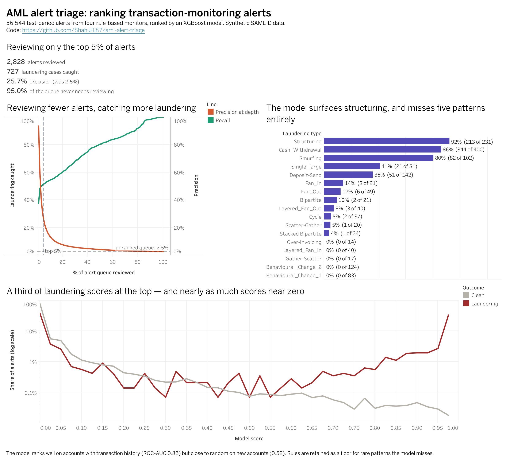

# AML alert triage: ranking transaction-monitoring alerts

Banks run rules that flag suspicious transactions for investigators to review. The rules are deliberately cautious, so the queue is huge and about 39 in every 40 alerts turn out to be innocent. This project builds that rules layer on 9.5 million synthetic transactions, then trains a model to rank the alert queue so investigators see the likeliest cases first.

**Result:** reviewing only the top 5% of ranked alerts catches about half of the laundering in the queue, at roughly 26% precision — about 1 in 4 reviewed alerts is real, against 1 in 40 unranked.

**Limitations:** the model only ranks well for accounts with transaction history, and it misses five laundering patterns entirely, including one the simple rules caught perfectly.

**Recommendation:** rank alerts with the model, but keep the rules running as a safety net for the patterns it misses.

*Click the image for the interactive version on Tableau Public.*
